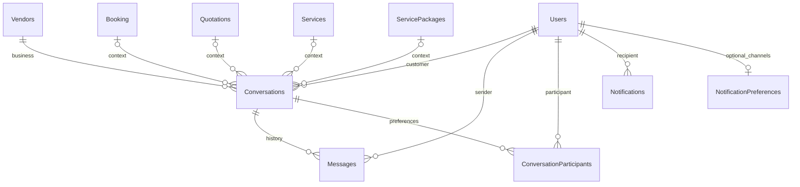

# Communication module

Implemented against the existing React/Express/MSSQL architecture. Existing `Conversations`, `Messages`, `Notifications`, JWT cookies, booking milestones, quotation history, Cloudinary storage and dashboard routes are reused. Customer and vendor legacy chat endpoints delegate to one communication service.

## Setup and deployment

Run commands from each package directory so the existing dotenv configuration is loaded:

```powershell
cd backend
npm ci
npm run db:migrate
npm start
# In another terminal, from frontend:
npm ci
npm run build
```

Migration `023-communication` has been applied to the configured development MSSQL database. Production startup checks that migration is present. Deploy the migration before the new API and frontend. The normal migration runner records the migration under its existing transaction/application lock. `migrations/023-communication.sql` is also the reviewable MSSQL DDL; the JavaScript migration executes it without introducing another migration system. Existing chat history is retained. There is no destructive down migration.

Required existing server settings:

| Variable | Purpose |
| --- | --- |
| `DB_NAME`, `DB_USER`, `DB_PASSWORD` | Existing MSSQL database and SQL authentication |
| `DB_HOST` or `DB_SERVER`, `DB_PORT` | MSSQL host; port defaults to 1433 |
| `DB_ENCRYPT`, `DB_TRUST_CERT` | Existing database TLS configuration; use a trusted production certificate |
| `JWT_SECRET` | Existing JWT signing secret, at least 32 random characters |
| `FRONTEND_URL` | Exact frontend origin for CORS, REST mutation checks and socket handshakes |
| `NODE_ENV`, `PORT` | Existing runtime mode and API port |
| `CLOUDINARY_CLOUD_NAME`, `CLOUDINARY_API_KEY`, `CLOUDINARY_API_SECRET` | Required for private attachment storage and retrieval |
| `BOOKING_JOBS_ENABLED` | Existing worker toggle; leave enabled for booking reminders and quotation expiry jobs |
| `OTP_SECRET`, `SMTP_HOST`, `SMTP_FROM` | Existing application's startup/authentication requirements; unchanged |
| `TRUST_PROXY_HOPS` | Existing optional proxy setting; configure to match the deployment |

Frontend uses existing `VITE_GRAPHQL_URL` to discover the API origin. Optional `VITE_COMMUNICATION_API_URL` overrides the REST base (default `<API origin>/api/communication`) and supplies the socket origin. Existing `VITE_CUSTOMER_API_URL` / `VITE_VENDOR_API_URL` still apply to legacy workspace endpoints. No new secret is required.

External dependencies: Microsoft SQL Server and Cloudinary authenticated raw storage. Socket.IO runs on the existing HTTP server; allow `/socket.io/` HTTP polling and WebSocket upgrades through the reverse proxy. The implementation supports a single Node API instance. Horizontal deployment needs a shared Socket.IO adapter and appropriate load-balancer affinity; presence and room routing currently use the in-memory adapter. REST database reconciliation remains authoritative.

Email and push delivery are not enabled for communication events. Existing SMTP is used for authentication; disabling optional communication notifications does not disable OTP/security mail. No email/push toggles or delivery queue are presented for unconfigured channels.

## Routes and user flows

Customer: `/customer/messages`, `/customer/notifications`, `/customer/notification-settings`.

Vendor: `/vendor/messages`, `/vendor/notifications`, `/vendor/notification-settings`.

Admin: `/admin/communication-overview`, `/admin/notifications`, `/admin/notification-settings`, plus the existing audit log tools.

The shared chat has searchable, paginated inbox/archive views, unread filters, participant names/images, context links, presence, typing expiry, date separators, distinct message bubbles, timestamps and sent/delivered/read labels. Mobile widths display either the conversation list or the selected conversation with a back button. Older messages use a server-issued cursor, avoiding MSSQL GUID ordering differences in JavaScript. Scrolling stays at the bottom only when already near it; loading older history preserves position. Failures preserve the draft and offer a retry using the same client message ID. Selected conversations load their own summary even when outside the current conversation-list page.

Uploads accept PDF, PNG and JPEG, at most 5 MiB decoded. Existing file signature validation is reused. Storage keys are kept private; uploads return a signed owner/conversation-scoped token. Downloads require current participant authorization every time and stream bytes through the API with an attachment disposition and `nosniff`. Image previews use local object URLs after authorized download; those URLs are revoked on close. Cloudinary URLs/keys are never exposed in message payloads. MIME signature validation is not malware scanning; no scanner service is configured in this project.

## REST API

Base: `/api/communication`. JSON responses use `{success:true,data:...}`. Errors return a safe `{success:false,message}`. Requests use the existing HTTP-only JWT session cookie and `credentials: include`. Set `X-Communication-Role: Customer|Vendor|Admin`; the backend verifies the selected role. Mutations also require `X-Communication-Request: 1` and the exact allowed `Origin`. Caller-supplied sender/customer IDs are rejected.

| Method | Path | Input / result |
| --- | --- | --- |
| POST | `/conversations` | Optional `vendorId,eventId,serviceId,packageId,bookingId,quotationId,requestId`; returns `{id}`. Customers select a vendor or an owned record. Vendors must start from an owned booking/request/quotation. All supplied context must match. |
| GET | `/conversations` | `page` (30 rows), `q`, `archived=0|1`, `unread=0|1`; returns `{rows,hasMore}`. |
| GET | `/conversations/:id` | Authorized participant/context summary; no sensitive customer contact details. |
| PATCH | `/conversations/:id/archive` | Archives for the caller. |
| PATCH | `/conversations/:id/restore` | Restores for the caller. |
| PATCH | `/conversations/:id/mute` | `{isMuted:boolean}`; mutes optional chat notifications for the caller. |
| GET | `/conversations/:id/messages` | Optional paired `before` (ISO datetime), `beforeId` (GUID); returns `{messages,hasMore,nextCursor}`. At most 50 rows. Reuse `nextCursor` verbatim. |
| POST | `/conversations/:id/messages` | `{text,clientMessageId,attachmentToken?}`; returns `{id}` only after transaction success. Text limit 5,000 characters; text or attachment required. `clientMessageId` is a GUID reused for retry. |
| PATCH | `/conversations/:id/delivered` | Recipient acknowledges fetched incoming messages. |
| PATCH | `/conversations/:id/read` | Marks incoming messages and matching chat notifications read, updates participant read watermark. |
| DELETE | `/messages/:id` | Sender only, within 15 minutes; leaves a tombstone and preserves retained history. |
| POST | `/conversations/:id/attachments` | `{name,base64}`; returns `{name,token}` after validated private storage. |
| GET | `/conversations/:id/messages/:messageId/file` | Authorized binary download; deleted message attachments are unavailable. |
| GET | `/notifications` | `page` (20 rows), `category=all|chat|booking|quotation|general`, `unread=0|1`; returns `{rows,hasMore}`. |
| GET | `/notifications/unread-count` | `{count}` for the authenticated user, excluding dismissed rows. |
| PATCH | `/notifications/read-all` | Marks caller's notifications read. |
| PATCH | `/notifications/:id/read` | Marks one owned notification read. |
| DELETE | `/notifications/:id` | Dismisses one owned notification, retaining the database record. |
| GET | `/notification-preferences` | `{chatEnabled,bookingEnabled,quotationEnabled}`. |
| PUT | `/notification-preferences` | Same three booleans, with strict validation. |
| GET | `/overview` | Admin-only aggregate counts; access is audited. No private message bodies or attachments. |

The existing `/api/customer/conversations...` and `/api/vendor/conversations...` routes remain compatible; they invoke the same service, ownership checks, limits and persistence. Their historical list shape is retained, bounded to the first 30 rows. The new screen uses the paginated API. Legacy callers without a client key receive a generated key; reliable client retries must supply their own stable GUID. Conversation-level read/delivery endpoints are intentionally used instead of a duplicate message-level read API.

Example:

```json
{
  "text": "Could you share the setup details?",
  "clientMessageId": "07d2031d-94db-4cc4-9dbe-f113ad590acc"
}
```

Default IP REST limit is 240 requests/minute. A shared database limiter enforces 60 sends/minute/user across REST and sockets, 10 uploads/minute/user, 30 socket connections/minute/user, 240 socket events/minute/user, and 90 typing events/minute/user. Socket payloads are capped at 20 KB; attachment bytes go through the upload REST endpoint.

## Socket.IO contract

Connect to the API origin with `withCredentials:true`. The server validates the existing signed JWT cookie, session, account eligibility and exact origin. Every incoming application event revalidates authentication and its schema; conversation events also require participant ownership. Idle sockets are revalidated every 15 seconds. No client can choose a user room; server-generated room names use canonical GUIDs. Presence is sent only to existing conversation counterparts. Multiple tabs keep the user online until the final socket disconnects.

Client event acknowledgements are `{ok:true,data}` or `{ok:false,message}`. Use an acknowledgement timeout, retain the retry key, and reconcile through REST after a network failure.

| Direction | Event | Payload / behavior |
| --- | --- | --- |
| Server lifecycle | `connection`, `disconnect` | Socket.IO lifecycle events. Client uses `connect` / `disconnect` for reconciliation. |
| Server → counterpart | `user_online`, `user_offline` | `{userId}`; only authorized existing contacts. |
| Client → server | `join_conversation` | `{conversationId}`; membership check, room join, acknowledgement `{online}`. |
| Client → server | `leave_conversation` | `{conversationId}`; leaves that socket's room. |
| Server → participants | `conversation_created` | `{conversationId,id}` after commit. |
| Server → participant(s) | `conversation_updated` | `{conversationId}`; refetch summaries/counts. Archive/mute updates go only to the caller. |
| Client → server | `send_message` | `{conversationId,message:{text,clientMessageId,attachmentToken?}}`; same service/transaction as REST. |
| Server → participants | `receive_message` | `{conversationId,id}` after commit; authorized REST fetch supplies message content. |
| Server → participants | `message_sent` | `{conversationId,id,clientMessageId}` after commit. |
| Client → server | `message_delivered`, `message_read` | `{conversationId}`; recipient acknowledgement is persisted. |
| Server → participants | `message_delivered`, `message_read` | `{conversationId,ids}` for affected incoming messages. |
| Server → participants | `message_deleted` | `{conversationId,id}`; refetch tombstone. |
| Client ↔ authorized room | `typing_start`, `typing_stop` | Incoming `{conversationId}`; outgoing also includes `userId`. UI expires typing after 3.5 seconds. |
| Server → recipient | `new_notification` | `{id?}`; refresh persisted inbox. |
| Server → recipient | `notification_read` | `{id}` or `{id:null}` for mark-all. |
| Server → recipient | `notification_count_updated` | Invalidation event; fetch authoritative count. |

Socket delivery alone is never considered persistence or delivery acknowledgement. Messages are `Sent` after database commit, `Delivered` after recipient acknowledgement, and `Read` after the recipient views the conversation. `Failed` describes a client attempt whose save could not be confirmed; no falsely successful database record is fabricated. A lost response can be retried with its key to recover the already committed ID. A key reused for different text/context/attachment is rejected.

On reconnect, clients reauthenticate, rejoin, reload conversation summaries and the latest message page, and merge by message ID. A 30-second visible-page reconciliation also recovers missed invalidations. History remains pageable after an extended disconnect. The existing dashboard counter polling is retained with immediate socket-triggered refreshes. Read receipts cannot regress, and stale responses cannot restore deleted content.

Reference: [Socket.IO delivery guarantees](https://socket.io/docs/v4/delivery-guarantees/) explains why persistence, acknowledgements and reconciliation are implemented at the application layer.

## Database relationships and retention



Existing conversation event and booking links remain. Nullable service/package/quotation/request foreign keys add the other supported contexts. GUID keys match the existing schema. `ConversationParticipants` stores per-user archive/mute/read state; membership is always derived from `Conversations.CustomerId` and the vendor's `UserId`, never from an arbitrary participant row. Unread counts derive from incoming nondeleted messages' existing `IsRead` field, avoiding a second counter that can drift. Two-person conversations need no duplicate receipt table: `DeliveredAt`, `ReadAt` and the existing `IsRead` represent the single recipient's state.

Messages add a unique filtered sender/client-key index, cursor index, receipt timestamps, deletion timestamp and attachment size. Notification records add category, event key and dismissal timestamp, plus a unique filtered `(UserId,EventKey)` index and inbox index. A customer/vendor application lock serializes conversation creation across full normalized context; every existing chat writer now uses it. No existing duplicate rows are destroyed. No cascading deletes are added.

Archive affects only one participant. Sender deletion is allowed for 15 minutes, hides content and attachment access, and retains the underlying history. Notifications are dismissed rather than physically removed. There is no automatic financial/chat-history purge; organizational retention and any future storage cleanup must be explicitly configured. Unattached uploaded files can remain in private Cloudinary storage; a storage retention/cleanup process is an operational follow-up if needed.

## Lifecycle integrations and permissions

Booking `milestone` keeps existing `BookingNotificationKeys` guards and creates notifications in the booking transaction with a stable booking/milestone key. Existing acceptance, rejection, confirmation, cancellation/change decisions, rescheduling, status changes and reminder flows continue to own the business rules. Quotation request, proposal/revision, negotiation, decision, conversion, expiry and reminder paths keep their existing history/transition guards and now use the centralized notification writer through the customer/business helper. Retried lifecycle transitions do not create duplicate records.

Existing service approval, vendor approval/account, administrator announcements and financial notification writers are bridged to the same post-commit realtime notification events through their existing repository/notification helpers. They retain their current approval/audit authorization. URLs are generated from supported entity types and the active workspace; the destination API independently verifies ownership.

Optional chat notifications respect both user preference and per-conversation mute. Booking and quotation preferences control optional reminders. Essential account/security and transactional status changes remain enabled. In-app preferences do not control authentication SMTP.

Customer/vendor APIs require current session and role. Vendor communication also requires approved, active vendor status. Reading, sending, room joins, receipts, attachment operations, archive/mute and deletion check backend membership. SQL replacements bind all user-controlled values; queries never interpolate request-supplied identifiers. React renders message content as text, preserving literal text without interpreting HTML. Errors omit SQL, credentials and internal stack traces.

Admin role does not authorize private conversations. The generic admin message resource, vendor message collection, and customer message collection are denied; corresponding message navigation tabs are removed. No exceptional message-support access is introduced. The admin overview contains aggregate metrics only and writes an audit entry. The existing admin audit tools remain available. Pending delivery counts mean recipients have not acknowledged messages, not that database saves failed. Email/push failure monitoring is omitted because those communication channels are not configured.

## Verification

See [communication-testing.md](communication-testing.md) for executable checks, results and verification limits.

## Created files

- `backend/migrations/023-communication.js`, `backend/migrations/023-communication.sql`
- `backend/src/modules/messaging/communication.service.js`, `communication.routes.js`, `socket-server.js`, `realtime-bus.js`
- `backend/src/modules/notifications/notification-center.service.js`, `notification-broadcast.js`
- `backend/scripts/verify-communication.js`, `backend/tests/communication-module.test.js`
- `backend/docs/communication-module.md`, `backend/docs/communication-testing.md`
- `frontend/src/modules/communication/ChatPage.jsx`, `Notifications.jsx`, `CommunicationOverview.jsx`, `useCommunicationSocket.js`, `api.js`, `communication.css`
- `frontend/tests/communication-module.test.js`

## Modified files for this task

- Backend `package.json`, `package-lock.json`, `server.js`, `src/app.js`, `scripts/migrate.js`
- Backend `src/modules/customers/workspace.messaging.js`, `workspace.common.js`
- Backend `src/modules/vendors/workspace.messaging.js`, `workspace.common.js`
- Backend `src/modules/notifications/admin-events.js`, `communications.service.js`
- Backend `src/modules/admin/admin.repository.js`, `admin.resources.js`, `booking-finance.js`, `customers.service.js`, `vendor-details.service.js`, `operations.service.js`
- Backend `scripts/verify-booking-lifecycle.js`, `scripts/verify-quotations.js` (current location fixtures and context-aware conversation expectation)
- Backend `tests/communications.test.js`, `admin-http.test.js`, `customer-details.test.js`, `vendor-details.test.js` (new notification and private-admin-access expectations)
- Frontend `package.json`, `package-lock.json`, `src/routes/AppRoutes.jsx`, `src/services/chat-sync.js`, `src/hooks/useCommunicationCounts.js`
- Frontend `src/modules/customer/CustomerLayout.jsx`, `pages/CustomerMessagesPage.jsx`, `pages/CustomerDiscovery.jsx`, `pages/CustomerRecords.jsx`
- Frontend `src/modules/vendor/layouts/VendorHeader.jsx`, `pages/VendorMessagesPage.jsx`
- Frontend `src/modules/admin/layouts/AdminHeader.jsx`, `navigation.js`, `pages/AdminInbox.jsx`, `pages/CustomerDetailsPage.jsx`, `pages/VendorDetailsPage.jsx`
- Frontend `src/modules/quotations/QuotationPages.jsx`, `src/modules/marketplace/DetailPage.jsx`

Other local changes were already present before this task and were preserved. No Home Page, public navbar/footer, global styles, shared visual components or Home assets were edited.
