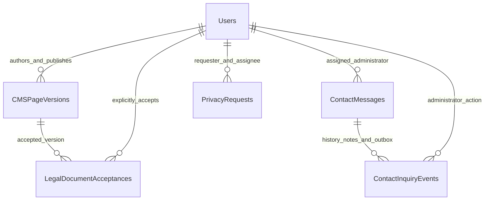

# Informational pages, content publishing and support

About and Contact now load published content from MSSQL. Terms and Privacy use the same versioned CMS, with complete editable outlines and a professional-review publication gate. Existing Home, shared navbar/footer, global CSS, assets and the `publicCompany` configuration used by Home remain unchanged.

## Run and configure

```powershell
cd backend
npm run db:migrate
npm test
node scripts/verify-content.js
npm start

# In a second terminal
cd frontend
npm test
npm run build
npm run dev
```

Migration `026-content-support` is integrated into the existing transactional migration runner. It has been applied to the configured development MSSQL database. It reuses `ContactMessages`, users, roles, audits, notifications, rate counters, authentication and the Media Library. It does not reset existing data. About/Contact receive editable published starter content without invented history or contact details; Terms/Privacy receive **private, incomplete drafts**. Rerunning migrations preserves existing versions.

| Variable | Purpose |
| --- | --- |
| `FRONTEND_URL` | Existing exact permitted frontend origin, including its port. Required for CMS/contact/privacy writes. |
| `PUBLIC_SITE_URL` | Public website origin used by `/sitemap.xml`; falls back to `FRONTEND_URL`. Set the deployed HTTPS origin in production. |
| `CMS_MAPS_ENABLED` | Default false. A published verified address and valid HTTPS Google Maps URL are also required before the map link appears. |
| `SUPPORT_MAIL_JOBS_ENABLED` | Default true. Processes the support outbox every 30 seconds. Disable when an external scheduler owns this job. |
| `SMTP_HOST`, `SMTP_PORT`, `SMTP_SECURE`, `SMTP_USER`, `SMTP_PASSWORD`, `SMTP_FROM` | Existing SMTP configuration reused from authentication. No new provider or credentials. |
| `VITE_GRAPHQL_URL` | Existing frontend API URL; the REST client uses its origin and `/api`. |

For an external scheduler, disable the built-in support job and run `node scripts/process-support-mail.js`. This command actually sends pending mail. Do not run it as a verification test. SMTP configuration and connectivity determine delivery; saving an inquiry succeeds independently of email availability. Do not publish a sender address as a support address without the owner's confirmation.

Serve the frontend SPA for public routes and reverse-proxy **`/sitemap.xml`** to the backend endpoint in production. The Vite development server has this exact proxy configured for port 5000; adjust it if the local API uses another port. `frontend/public/robots.txt` excludes private workspaces, auth and API routes. The sitemap lists only published informational/legal pages, with publication timestamps. Existing footer links already point to the canonical page routes and needed no changes.

## Screens and operator workflow

| Route | Behavior |
| --- | --- |
| `/about` | Published story/purpose, mission, vision, live active categories, category overrides, approved platform images, benefits, process and CTAs. |
| `/contact` | Published contact information, configurable validated form, reference confirmation, FAQs, socials and conditional verified map link. |
| `/terms-and-conditions` | Current published Terms, dates, version, table of contents and printable layout. `/terms` redirects here. |
| `/privacy-policy` | Current published Privacy document plus authenticated privacy request center. `/privacy` redirects here. |
| `/customer/legal`, `/vendor/legal` | Current acceptance requirements, explicit acceptance actions, own acceptance history, privacy request submission and responses. |
| `/admin/content` | Four CMS page tabs, private drafts, structured plain-text editors, saved previews, publish confirmation, archive and version/audit history. |
| `/admin/contact-inquiries` | Search/filter/page inquiries; inspect history; assign an active administrator; change status; add private notes; queue customer replies. |
| `/admin/privacy-requests` | Review requests, assign an administrator, set status and send a response visible to the requesting user. |

Open/create a draft, edit, save, preview the saved version and publish. Draft changes are never exposed through the public CMS API. A revision number prevents stale saves/publication. Publishing archives the previous current version atomically and keeps its content unchanged. Copy an old version to a draft to restore its content; current published records cannot be overwritten or directly archived without a replacement. Drafts can be archived. Published and archived payloads also have an MSSQL immutability trigger.

Only active authenticated `ADMIN` users can edit, publish or manage support records. The existing role model has no distinct editor/publisher/support-staff permission, so these actions share that administrator role. Assignment is restricted to active unblocked administrators. Publication stores publisher ID/time and an audit entry. System-seeded nonlegal versions have no human publisher.

The legal drafts contain all 30 requested Terms sections and 27 Privacy sections, with empty bodies. The owner must supply wording reflecting the actual business and configured providers and obtain qualified professional review. Legal publication requires a current/past effective date, content in every outline section, introduction, SEO description and an explicit review attestation for that exact draft revision. This records the administrator's confirmation; the software cannot certify the quality of a professional review. Scheduled publication is not implemented, and future dates are rejected. Unpublished legal pages show an unavailable notice and `noindex` instead of policy text.

Set **Requires acceptance** on a legal draft only when the approved policy requires it. Reading a page never records acceptance. The legal center offers a clearly labeled explicit button for a specific published version. Signup checkboxes show available version numbers and submit the IDs captured when checked. The server rejects obsolete versions and missing required IDs; it never attaches an unseen version to a legacy checkbox. Existing account acceptance timestamps remain historical unversioned data; they are not backfilled into versioned acceptances. Acceptance status reports when the approved flag requires re-acceptance. No new global blocking of payments/bookings is introduced.

Contact email, phone, address, hours and socials start empty and are editable in the CMS. They are not invented or taken from placeholder configuration. The existing Home/footer company configuration is deliberately independent to satisfy Home protection. Updating CMS contact information affects the Contact page. Attachments are disabled, so this module has no contact upload surface. CMS images reuse approved, ready, undeleted administrator images from the existing Media Library. Referenced CMS version images are retained by media cleanup, including images in archived versions.

## REST API

All JSON responses follow `{ success, data }` on success or `{ success: false, message }` on failure. Public CMS responses have an ETag and require revalidation; private responses have `Cache-Control: no-store` and `X-Robots-Tag: noindex, nofollow`. Unknown/unpublished public pages return 404. Validation errors return 400, unauthorized/forbidden access 401/403, stale changes 409 and rate limits 429. Internal errors return a generic message.

Writes require the exact configured `Origin` plus `X-CMS-Request: 1` (existing role request headers also work). The frontend sends existing HttpOnly JWT cookies with credentials and uses the existing refresh flow. An endpoint never accepts a caller-supplied user ID as authority.

| Method | Path | Access / input |
| --- | --- | --- |
| GET | `/api/cms/:key` | Public. `about-us`, `contact`, `terms`, `privacy`; only the published version. |
| POST | `/api/contact` | Public. `fullName`, `email`, optional `phone`, `subject`, `category`, `message`, `consent:true`, GUID `requestKey`, empty `website` honeypot. |
| GET | `/api/admin/cms/pages` | Admin. Version summaries for all four pages. |
| POST | `/api/admin/cms/pages` | Admin. `{pageKey, sourceId?}`; returns existing draft or creates the next version. |
| GET | `/api/admin/cms/pages/:id` | Admin. Content and audit history, including drafts/archived versions. |
| PUT | `/api/admin/cms/pages/:id` | Admin. `{expectedRevision, content, requiresAcceptance, effectiveDate}`; drafts only. |
| POST | `/api/admin/cms/pages/:id/publish` | Admin. `{expectedRevision, legalReviewed}`. |
| POST | `/api/admin/cms/pages/:id/archive` | Admin. Archives a draft; current published versions require a replacement. |
| GET | `/api/admin/cms/pages/:id/versions` | Admin. Same-page version summaries. |
| GET | `/api/admin/contact-inquiries` | Admin. `page`, `pageSize`, `q`, `status`, `category`, `from`, `to`. |
| GET | `/api/admin/contact-inquiries/staff` | Admin. Eligible assignees. |
| GET | `/api/admin/contact-inquiries/:id` | Admin. Full inquiry, delivery/status/assignment history and private notes. |
| PATCH | `/api/admin/contact-inquiries/:id/status` | Admin. `{status, reason?}`. |
| PATCH | `/api/admin/contact-inquiries/:id/assign` | Admin. `{assignedTo: GUID or null}`. |
| POST | `/api/admin/contact-inquiries/:id/notes` | Admin. `{note}`. Never sent to the customer. |
| POST | `/api/admin/contact-inquiries/:id/reply` | Admin. `{body, requestKey}`. Requires configured SMTP and a non-Spam inquiry. |
| GET | `/api/legal/current` | Public. Published legal version summaries for signup. |
| POST | `/api/legal/accept` | Authenticated. `{explicit:true, versionIds:[GUID]}`; current legal versions only. |
| GET | `/api/legal/acceptance-status` | Authenticated. Own current status and version history. |
| POST | `/api/privacy-requests` | Authenticated. `{requestType, description, requestKey, explicit:true}`. |
| GET | `/api/privacy-requests/my-requests` | Authenticated. Own paginated requests and admin responses. |
| GET | `/api/admin/privacy-requests` | Admin. Paginated requests, requester and assignment information. |
| PATCH | `/api/admin/privacy-requests/:id/status` | Admin. `{status, response, assignedTo?}`; response required for Resolved/Closed. |
| GET | `/sitemap.xml` | Public. Published informational/legal routes only. |

CMS content is structured JSON validated by `cms.validation.js`: title/introduction/SEO; sections with stable IDs, title and plain-text body; benefits; process steps; customer/vendor benefits; safe internal CTAs; category description/image overrides; FAQs; contact settings. HTML is rejected in CMS and inquiry text; React renders text nodes without raw HTML. Category names come from the actual category table, and overrides affect only About.

Contact categories: `GENERAL`, `CUSTOMER`, `VENDOR`, `BOOKING`, `QUOTATION`, `PAYMENT`, `TECHNICAL`, `PARTNERSHIP`, `OTHER`, plus existing `CANCELLATION`. Status values: `New`, `InProgress`, `WaitingForCustomer`, `Resolved`, `Closed`, `Spam`. Resolution/closure sets a timestamp; reopening clears it. List bounds are 1–50 rows. Search uses bound, escaped LIKE values; SQL never interpolates user data. Date filters use inclusive UTC calendar dates (`to` includes that entire day); inverted ranges are rejected.

Privacy request types: `Access`, `Correction`, `AccountDeletion`, `DataDeletion`, `WithdrawConsent`, `Question`. These are authenticated review requests. Status changes and responses do not automatically delete data, cancel bookings or change consent settings. The team must carry out approved actions through the appropriate existing operational procedures. No automatic deletion, retention deadline or legal right is promised by generated wording. Anonymous requests are not implemented; logged-out users can contact support.

The previous GraphQL `submitContactMessage` mutation delegates to the same contact service and returns its saved reference. It is a compatibility adapter, not a second inquiry workflow/table.

## Inquiry integrity and mail behavior

The server saves an inquiry and a unique `MN-…` reference before responding. Same-key/same-payload replays return the saved reference; different payloads with that key fail. Identical email/content within 15 minutes also returns the existing reference. Backend constraints, application locks, a honeypot, strict validation and persistent per-IP limits protect submission. Privacy requests have persistent per-user limits and user/request-key uniqueness. REST requests also have minute-level read/write limits. Requests/messages are not accepted with forged ownership/status fields.

Acknowledgements are queued when enabled and SMTP is configured, with a maximum of three per recipient in a day. An administrator notification is created in the same inquiry transaction. Replies use a request key and stored recipient; private notes are not included. A worker claims each pending mail once and tracks delivery in history. Spam suppresses pending messages and blocks new replies until reopened. Already in-flight SMTP cannot be recalled.

SMTP failures or expired delivery leases become **Unknown**, because the provider may already have accepted mail. These events are not automatically retried, which avoids duplicate delivery after an ambiguous response. Inspect provider logs before deliberately creating another reply. `Sent` means the SMTP server accepted the recipient, not that the recipient read the message. Unconfigured/disabled acknowledgement delivery remains visible in admin history. Inquiry records are never exposed through a public reference lookup; that optional endpoint was intentionally omitted because no secure tracking token workflow exists.

## MSSQL relationships



`CMSPageVersions` is the canonical page/version table, with a constrained page key and unique `(PageKey, VersionNumber)`. Filtered unique indexes enforce one current publication and one open draft per page. A separate duplicate CMSPages table is unnecessary. `LegalDocumentAcceptances` references users and immutable versions, with uniqueness per user/version. `ContactMessages` is extended with reference/name/request-key/hash/assignment/resolution fields. `ContactInquiryEvents` consolidates notes, history and transactional mail outbox using an event type. `PrivacyRequests` references its authenticated requester and optional admin assignee. Foreign keys, GUID defaults, status constraints and list/duplicate indexes are in migration 026. Existing AuditLogs and Notifications remain the canonical audit/notification stores.

## Verification and remaining operator work

- Backend: **211 tests passed** (includes six new CMS/support tests and existing OTP tests after transport reuse).
- Frontend: **38 tests passed**, including new CMS CSS isolation and support notification links, plus hashes for all 65 protected Home/shared files.
- `node scripts/verify-content.js`: **61 actual MSSQL/HTTP checks**, including migration idempotency, draft/public separation, version preservation, stale edits, professional-review gating, explicit/stale/versioned signup acceptance, inquiry deduplication/private notes, assignment/status/reopening, mocked email/SMTP uncertainty/Spam, own-user privacy isolation, responses, ETags, auth and sitemap. All fixtures and rate/outbox changes roll back; SMTP is mocked.
- Media integration regression: **69 MSSQL/HTTP checks passed**, fixtures rolled back.
- Frontend production build passes; targeted lint for changed UI modules passes.
- The in-app Browser connection fails before page access. Rendered desktop/mobile/print layouts and pixel comparison remain **unverified**. File hashes establish source preservation, not a screenshot-level guarantee. Responsive grids, mobile TOC, scoped print styles, reduced-motion handling, keyboard-accessible dialogs, labels and focus behavior are implemented.

Before publishing legal pages, complete professional review and supply approved wording. Supply actual contact information through Content Management. Configure production origin/proxy and SMTP. No live test email was sent and no real inquiry or privacy request was created during verification.

## Files for this module

Created:

- `backend/migrations/026-content-support.{js,sql}`
- `backend/src/modules/cms/{cms.routes,cms.service,cms.templates,cms.validation,support.service,support.validation,support.jobs,sitemap}.js`
- `backend/src/modules/auth/mail.service.js`
- `backend/scripts/{inspect-content,process-support-mail,verify-content}.js`
- `backend/tests/content.test.js`
- `backend/docs/content-and-support.md`
- `frontend/src/modules/content/{AdminContent,InfoPages,ContentState}.jsx`, `api.js`, `content.css`
- `frontend/public/robots.txt`, `frontend/tests/content-protection.test.js`

Integrated/modified:

- `backend/.env.example`, `backend/scripts/migrate.js`, `backend/server.js`, `backend/src/app.js`
- `backend/src/graphql/auth/auth.typeDefs.js`, `backend/src/graphql/public.typeDefs.js`
- `backend/src/modules/auth/{auth.service,auth.validation,otp.service}.js`
- `backend/src/modules/public/{public.service,public.validation}.js`
- `backend/src/modules/notifications/{admin-events,notification-center.service}.js`
- `backend/src/modules/media/media.cleanup.js` (retain images referenced by CMS versions)
- `frontend/src/modules/public/pages/{AboutPage,ContactPage,TermsAndConditionsPage}.jsx`
- `frontend/src/modules/auth/pages/RegisterPage.jsx`, `frontend/src/routes/AppRoutes.jsx`
- `frontend/src/modules/admin/{navigation,notification-links}.js`
- `frontend/src/modules/customer/layouts/CustomerSidebar.jsx`, `frontend/src/modules/vendor/navigation.js`
- `frontend/vite.config.js`, `frontend/tests/admin-notifications.test.js`

Earlier Reviews/Media work remains in the workspace and has not been discarded.
